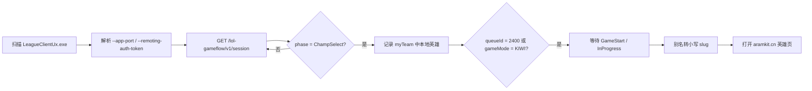

# ARAMKit Invoker

[](https://github.com/eliozh/aramkit-invoker/actions/workflows/build-windows.yml)

Windows 桌面小工具：通过英雄联盟国服客户端的本地 LCU API，在**海克斯大乱斗（ARAM: Mayhem，队列 2400）**确认进入游戏后，自动在独立的 Microsoft Edge 窗口中打开对应英雄的 ARAMKit 页面：

```text
https://aramkit.cn/zh-CN/champions/<champion>
```

## 功能

- 自动发现正在运行的 `LeagueClientUx.exe`，读取它的 LCU 端口与临时令牌。
- 轮询游戏流程状态；在海克斯大乱斗英雄选择期间记录本地玩家英雄。
- 在英雄选择结束、客户端进入 `GameStart`（约 2 秒宽限）或 `InProgress` 时打开 ARAMKit 页面；秒退或加载失败不会误触发。
- 关闭主窗口时最小化到系统托盘；托盘图标悬停显示：
  - `等待客户端连接`
  - `客户端已连接`
- 主窗口实时显示连接状态、当前阶段、队列、英雄和最近打开的页面。
- 可配置 ARAMKit 桌面程序路径；此后每次启动本程序都会自动启动它。

## 构建

建议直接在 Windows 上构建（需要 Rust MSVC 工具链和 Visual Studio Build Tools）。

```powershell
rustup default stable
cargo build --release
```

产物：

```text
target\release\aramkit-invoker.exe
```

依赖使用 Windows 自带的 SChannel（`native-tls`），不需要额外安装 OpenSSL。

也可以用 GitHub Actions 构建：推送到 `main`、手动运行 **build-windows** workflow，或推送 `v*` 标签。普通构建的 exe 在 Actions 的 artifact `aramkit-invoker-windows-x64` 中；`v*` 标签会自动创建 GitHub Release 并附加 exe。

Linux 下仅用于代码检查/单元测试，托盘和文件选择器是 Windows 专用：

```bash
cargo test
cargo clippy --all-targets -- -D warnings
cargo check --target x86_64-pc-windows-msvc
```

## 使用

1. 启动 `aramkit-invoker.exe`。
2. 在“ARAMKit 桌面端”一栏选择 ARAMKit 的 `.exe` 或 `.lnk` 路径，路径会自动保存。
3. 在“客户端状态”中展开“启动设置”，再选择 TCLS 或 WeGame。程序会从 Windows 注册表检测启动路径，也可以填写自己的 `.exe` 或 `.lnk` 路径。在“本程序启动时”选择客户端后会自动保存，默认不自动启动。
4. 英雄选择结束、进入加载界面时，程序会自动打开对应英雄的 ARAMKit 专用窗口。下一局会在同一窗口切换英雄页面，点击“再次打开”也会复用该窗口。从托盘退出程序时会关闭专用窗口。
5. 关闭窗口不会退出程序；右键托盘图标可“显示主窗口”或“退出”。

配置文件位置：

```text
%APPDATA%\aramkit-invoker\config.json
```

## 工作方式



使用的只读 LCU 接口：

- `GET /lol-gameflow/v1/session` — 游戏阶段、队列、游戏 ID。
- `GET /lol-champ-select/v1/session` — 本地玩家格位与当前英雄。
- `GET /lol-game-data/assets/v1/champion-summary.json` — 英雄 ID → 名称/别名。

触发只在“英雄选择结束并进入游戏”时发生，因此英雄选择期间有人秒退不会打开页面。英雄在海克斯大乱斗中换人（骰子/交换）时，会记录最后一次看到的英雄。

## 开发者：本地 LCU mock（仅开发/测试）

仓库包含一个**仅用于开发与测试**的本地 LCU mock：`examples/LeagueClientUx/`。它的可执行目标名就是
`LeagueClientUx`（Windows 上为 `LeagueClientUx.exe`），因此未修改的应用会像发现真实客户端一样发现它。
mock 只监听 `127.0.0.1`、使用 `Basic riot:<token>`、只提供应用实际使用的四个只读接口，**永远不会进入
release 产物、安装包或 CI artifact**（`examples/` 不参与 `cargo build --release`）。

### 构建与运行

```bash
cargo build --example LeagueClientUx
cargo test --all-targets --locked
cargo run --example LeagueClientUx -- --scenario mayhem
```

### 三种发现模式

| 模式 | 命令 | 行为 |
|---|---|---|
| `process`（默认） | `cargo run --example LeagueClientUx -- --scenario mayhem` | 在进程 argv 中公布一次 `--app-port=<p> --remoting-auth-token=<t>`；缺少参数时自动选择回环端口、生成令牌，并重新执行自身一次。对应应用的 Candidate A。 |
| `lockfile` | `cargo run --example LeagueClientUx -- --mode lockfile --install-root <绝对目录>` | 先写 `<root>/lockfile`（内容恰为 `LeagueClientUx:<pid>:<port>:<token>:https`），再开始监听。不在 argv 中公布凭证。对应 Candidate B。 |
| `log` | `cargo run --example LeagueClientUx -- --mode log --install-root <绝对目录>` | 先写 `<root>/Game/Logs/LeagueClient Logs/<timestamp>_LeagueClientUx.log`，前 64 KiB 含 `--app-port=<p> --remoting-auth-token=<t>`，再开始监听。对应 Candidate B 的日志回退。 |

`--install-root` 只能用于 `lockfile`/`log` 模式（在 `process` 模式下会以退出码 2 拒绝）。默认根目录是 mock
可执行文件所在目录。写入前会严格校验根目录：

- 必须是**已存在的绝对目录**；拒绝相对路径、UNC 路径（`\\server\share`、`//server/share`）、`..`、
  符号链接，以及任何上级目录中包含 `LeagueClient.exe`（或非 mock 自身的 `LeagueClientUx.exe`）的根目录。
  根目录会先规范化为真实路径；所有写入只使用该规范路径，绝不使用原始输入。
- 拒绝已知的 Riot/Tencent/WeGame 安装前缀（按规范化后的前缀比较，Windows 上先折叠路径组件的尾随点/空格）。
- 只允许上述两种输出路径；Unix 上文件权限为 `0600`、新建目录为 `0700`，Windows 使用目录默认 ACL。
  lockfile 以 `O_NOFOLLOW` 打开（Unix），日志文件用 `create_new` 创建并在重名时追加数字后缀。
- 在 Unix 上，收到 SIGINT、SIGTERM、SIGHUP 或 SIGQUIT 时，mock 会先停止监听、删除它创建的发现文件，
  再以退出码 0 结束；Windows 上仅 SIGINT（Ctrl+C）可用，Ctrl+C 同样会清理并以退出码 0 结束。
- SIGKILL（`kill -9`）和 SIGSTOP 不能被进程处理，因此会留下发现文件；请始终使用临时根目录，必要时手动删除。

示例（PowerShell，Candidate B）：

```powershell
New-Item -ItemType Directory -Force "$env:TEMP\aramkit-lcu-mock" | Out-Null
Copy-Item .\target\debug\examples\LeagueClientUx.exe "$env:TEMP\aramkit-lcu-mock\"
& "$env:TEMP\aramkit-lcu-mock\LeagueClientUx.exe" --mode lockfile --install-root "$env:TEMP\aramkit-lcu-mock"
```

必须先把示例二进制**复制到临时目录**再运行：应用会从进程映像路径推导安装根目录，复制后该根目录也是临时的，
不会碰到真实安装。

### 场景与开关

- 默认 `--scenario mayhem`：`Lobby`（2×）→ `ChampSelect`（12×）→ `GameStart`（4×）→ `InProgress`（保持）。
- `--step-ms <毫秒>`：每步的倍数，默认 `1000`（即 `ChampSelect` 约 12 秒、`GameStart` 约 4 秒）。手动联调建议
  保持默认；低于约 `250` 会让应用来不及观察 `ChampSelect`。
- `--scenario non-mayhem|dodge|failed-to-launch`：验证不触发路径。
- `--reject-auth`：所有请求返回 `401`，用于观察应用的“客户端凭证已失效，正在重新读取”重试路径，且不打开页面。
- `--gameflow-phase-only`：`/lol-gameflow/v1/session` 返回 `404`，让应用走 `/lol-gameflow/v1/gameflow-phase`
  的裸字符串回退。
- 静态固定状态：`--phase ChampSelect --queue-id 2400 --game-mode KIWI --champion-id 103 --local-cell-id 2`
  直接提供指定阶段/队列/英雄，用于检查接口和界面（不依赖时间线）。

```bash
cargo run --example LeagueClientUx -- --phase ChampSelect --champion-id 103 --queue-id 2400 --game-mode KIWI
cargo run --example LeagueClientUx -- --reject-auth
cargo run --example LeagueClientUx -- --gameflow-phase-only --phase InProgress
```

### Windows 端到端验证

1. **先完全退出真实的英雄联盟客户端**（TCLS/WeGame、Riot Client 和游戏进程），否则应用可能选中真实客户端。
2. 在 Windows 上构建：`cargo build --example LeagueClientUx`。
3. Candidate A：运行 `target\debug\examples\LeagueClientUx.exe --scenario mayhem`，再启动本应用。
   - 预期：约 3 秒内应用从“请启动英雄联盟客户端”变为已连接；约 2 秒后进入 `ChampSelect`；
     在 `GameStart`/`InProgress` 时**恰好打开一个** `https://aramkit.cn/zh-CN/champions/ahri` 页面。
4. Candidate B：按上面的 PowerShell 片段把示例二进制复制到临时目录，以 `--mode lockfile`（或 `--mode log`）
   运行，再启动本应用。
   - 预期：应用通过 lockfile（或日志）完成发现，连接与触发行为应与 Candidate A 相同。
   - 注意：Candidate B 的端到端发现仅限 Windows，因为应用的 `process_image_path` 只在 Windows 上可用；
     Linux 上的 writer/parser 单测覆盖了文件格式本身。
5. 可选：`Get-NetTCPConnection -LocalPort <port>` 应只看到 `127.0.0.1`。

### 测试证书说明

`examples/LeagueClientUx/testdata/cert.der` 和 `key.der` 是**提交在仓库中的、非机密的测试夹具**：自签名、
只用于回环 mock 的 TLS，不用于生产、不安装进系统信任库、也不会随 release 发布。密钥公开是设计的一部分，
它不能认证 mock 之外的任何东西；秘密扫描器可能会误报，这是已知且可接受的。

mock 永远不会随产品发布：`Cargo.toml` 的 `exclude` 排除 `examples/LeagueClientUx/`，release 构建不会编译
example，CI 只上传 `aramkit-invoker.exe`。

## 安全说明

- 只访问 `https://127.0.0.1:<LCU端口>`，关闭系统代理并禁用 HTTP 重定向，避免请求离开回环地址。
- LCU 使用自签名证书，客户端仅对回环地址关闭证书校验。
- 令牌只存在内存中，不写配置、不打印日志（`Debug` 输出已脱敏），释放时清零。
- 本地接口响应限制为 2 MB，防止异常响应耗尽内存。
- 浏览器只允许打开 `https://aramkit.cn/zh-CN/champions/` 下、由字母数字 slug 组成的页面。
- ARAMKit 桌面端路径仅允许**绝对本地路径**且后缀为 `.exe` / `.lnk`；拒绝 UNC/相对路径，使用 `ShellExecuteW` 启动，不经过 `cmd.exe`。
- 不注入游戏进程、不修改客户端，只读取本地 API。
- 本工具信任本机运行的 League 客户端；请在可信的电脑环境中使用。

## 已知限制

- 仅支持 Windows；程序需要在英雄选择结束前保持运行。
- 如果 Riot 更改了海克斯大乱斗的队列号，请修改 `src/champion.rs` 中的 `MAYHEM_QUEUE_ID`（当前为 `2400`）。
- 页面在加载界面阶段打开；如果希望更早打开，可调整 `src/tracker.rs` 的触发阶段。
- 系统托盘使用 `tray-icon`；若 Explorer 未就绪，托盘创建可能失败，此时程序会在日志中提示，关闭窗口将直接退出。
- 国服（WeGame）客户端常以管理员权限运行：普通权限的程序读不到它的命令行，且 `lockfile` 可能为 0 字节。此时程序会自动改用客户端日志 `Game\Logs\LeagueClient Logs\*_LeagueClientUx.log` 中的启动参数获取端口与令牌，无需管理员权限。

## 目录结构

```text
src/
├── main.rs          应用入口与窗口参数
├── app.rs           egui 界面、托盘联动、配置交互
├── theme.rs         颜色、样式与展示辅助
├── tray.rs          Windows 系统托盘（其他平台为开发用占位实现）
├── icon.rs          运行时生成的应用/托盘图标
├── lib.rs
├── champion.rs      英雄 slug、ARAMKit URL、队列判断
├── config.rs        JSON 配置读写
├── platform.rs      打开浏览器、启动桌面程序、文件选择
├── tracker.rs       海克斯大乱斗英雄确认状态机
└── lcu/
    ├── mod.rs       事件与状态类型
    ├── creds.rs     进程/命令行/lockfile/客户端日志 凭据发现
    ├── model.rs     LCU JSON 模型
    ├── client.rs    HTTPS 请求
    └── watcher.rs   后台轮询与触发
```
